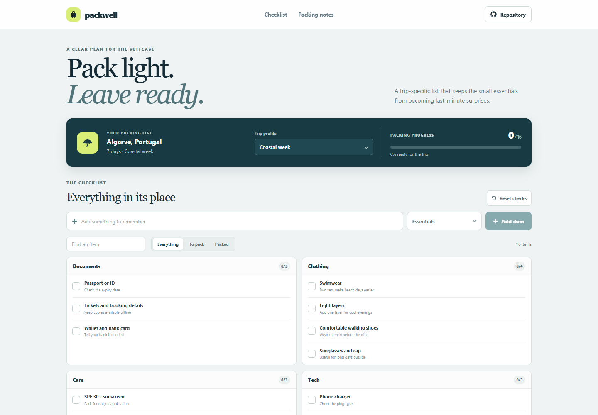

# Packing Checklist

Packwell is a trip-specific packing list for travelers who want a clear view of what is ready and what is still missing. Choose a trip profile, check off packed items, and add personal reminders as the plan changes.

**Live site:** [https://a2rp.github.io/packing-checklist/](https://a2rp.github.io/packing-checklist/)

## What is included

- A fixed header with links to the checklist and packing notes, plus a repository link.
- Three trip profiles: a coastal week in Portugal, a city weekend in Lisbon, and a cabin and trail trip in the Dolomites. Changing the profile loads its separate list.
- A packing progress count, percentage, and progress bar for the selected trip.
- Items grouped into documents, clothing, care, tech, and essentials.
- Checkboxes to mark items packed. Packed items remain visible with a clear completed state.
- An item search and filters for everything, items to pack, and packed items.
- A form to add a custom item to a selected category. Custom items can be removed with a confirmation dialog.
- A reset action that clears packed checks for the current trip after confirmation. Cancel, Escape, or closing the dialog leaves the list unchanged.
- Responsive desktop and mobile layouts, an explanatory packing note, a two-sided social and support footer, and a Back to top button after scrolling more than 50 pixels.

## Privacy and storage

Trip profiles, packed states, and custom items are stored in this browser's `localStorage` under `packwell-workspace`. Each trip keeps its own item list. The app does not upload personal packing notes. Clearing site data removes saved lists.

## Run locally

Use Node.js and npm, then run these commands from this directory:

```sh
npm install
npm run dev
```

## Checks and deployment

```sh
npm run lint
npm run build
npm run deploy
```

The deploy command builds the site and publishes `dist` to the `gh-pages` branch. Vite uses `/packing-checklist/` as its project-page base path.

## Future improvements

These are ideas and are not implemented yet:

- Let travelers set trip dates and adjust clothing quantities by length of stay.
- Add optional packing templates that can be copied into a new trip profile.
- Add a printable checklist and export to a simple text file.
- Support custom trip profiles and item categories.

## Links

- Portfolio: [https://www.ashishranjan.net](https://www.ashishranjan.net)
- GitHub: [https://github.com/a2rp](https://github.com/a2rp)
- CodePen: [https://codepen.io/ash1198](https://codepen.io/ash1198)
- LinkedIn: [https://www.linkedin.com/in/aashishranjan](https://www.linkedin.com/in/aashishranjan)
- Facebook: [https://www.facebook.com/theash.ashish/](https://www.facebook.com/theash.ashish/)
- YouTube: [https://www.youtube.com/@ashishranjan-ashz?sub_confirmation=1](https://www.youtube.com/@ashishranjan-ashz?sub_confirmation=1)
- Email: [mailto:ash.ranjan09@gmail.com](mailto:ash.ranjan09@gmail.com)

## Support

- Support: [https://a2rp-donation-page.netlify.app/](https://a2rp-donation-page.netlify.app/)
- Buy Me a Coffee: [https://buymeacoffee.com/ashishranjan](https://buymeacoffee.com/ashishranjan)
- Patreon: [https://www.patreon.com/ashishranjan](https://www.patreon.com/ashishranjan)
